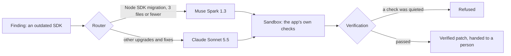

# sustain-muse

Apps built by small teams rot quietly. An SDK falls out of support, a dependency drifts a major
version behind, a vendor retires an API, and the app keeps working until the day it stops.
[Sustain](https://sustain.zetesis.dev) watches for that. On its Maintain tier it also fixes the
routine cases: an agent writes the fix in a sandbox, the app's own checks run on it, and a person
gets a verified patch to apply.

This repository is the part of Sustain that brings in Meta's Muse models, with the evals that
decided where they run.

<!-- source -->Code and eval files copied unchanged from Sustain's private repository at commit `dfcffd9`, 2026-10-28.<!-- /source -->



## Where Muse runs

Nobody using Sustain picks a model. Each task has a route in a fixed table, and a route changes
only with an eval run behind it, which the route names in `chosenBy`. The table is
[`packages/llm/src/router.config.ts`](packages/llm/src/router.config.ts).

Node SDK migrations whose task names 3 files or fewer go to Muse Spark 1.3. I ran Spark on the 7
such cases in our evals, two runs each: four from open-source apps and three from the rot lab, our
own Flutter and Firebase app for testing Sustain. It passed 14 of 14. Claude Sonnet 5.5, which
held the route, also passed 14 of 14 on the same cases. Spark cost $0.0817 a run and Sonnet
$0.0804, and I gave the tie to Muse. On the one larger case, 8 files, Spark passed one run of two
and Sonnet both, so larger migrations stay on Sonnet.

The route is picked where a fix starts, in code that isn't in this excerpt:

```ts
// jobs/src/fixes/run.ts
const files = context.finding.complete ? task.files.length : 0
const ref = agentRoute(WORK[taskClass], taskClass, fix.ecosystem, files).primary
```

A fix knows its size before the agent starts: its task names the finding's files, plus the
manifest when a package has to move. A finding keeps at most 10 matches per component and doesn't
say how many it dropped, so a fix whose finding left matches out, or kept exactly 10, counts as
naming no files and takes the default route.

Whether a class of fix runs at all is a separate gate. [`packages/agent/src/bar.ts`](packages/agent/src/bar.ts)
lists, for each ecosystem, the classes whose routed model passed 80 percent of its runs there.
Node SDK migrations are one of them.

## How Muse is called

Meta's Model API speaks OpenAI's Chat Completions at `https://api.meta.ai/v1`, so Sustain reaches
it through the AI SDK's OpenAI provider, which it already used. No dependency was added
([`call.ts`](packages/llm/src/call.ts)). Two things needed handling.

The AI SDK sends a reasoning effort only to OpenAI models it knows can reason, and it doesn't know
Muse. `providerOptions` tells it that Muse reasons, and keeps the system prompt a system message.

Meta caches a repeated prompt on its own, and an agent resends the whole conversation every turn.
Muse Spark bills a cached input token at $0.15 a million, against $1.25 for a new one. Sustain
counted every token at the full rate, against a budget of 600,000 input tokens a run, and 12 of
the 13 Muse runs that failed in `evals/muse.md` stopped on that budget. Now a call's cost prices
cached tokens at the cached rate, and the budget counts only the tokens a run reads for the first
time. A cached count that can't be true (more than the call read, negative, or fractional) counts
as zero, so usage that contradicts itself is priced and counted in full.

An agent step ([`agent.ts`](packages/llm/src/agent.ts)) sends a request again only when the
provider turned it away unread, with a 429 or a 529, after the wait it asks for. A failure that
may have been charged goes back to the agent's loop, which decides by its budget.

## What a fix on Muse goes through

Muse works under the same rules as every model Sustain routes to. Its tool calls run in an E2B
sandbox with no network, and the agent's loop checks each one before it runs. Every prompt and tool
result is redacted on the way out ([`redact.ts`](packages/llm/src/redact.ts)), and every call is
logged with what it cost. The patch then goes through the same verification as any other model's:
the app's own checks run, and Sustain refuses a patch that quiets one with an ignore comment, a
skipped or deleted test, or a changed test or lint setting. A verified patch goes to a person.
Sustain pushes nothing.

On 2026-10-27 I ran finding SUS-0081 end to end on Muse Spark, against the rot lab's real
repository: its Cloud Functions moved from the OpenAI Node SDK v3 to v4. The patch was verified
and handed off. It changed 3 files, in 22 agent steps, for $0.089, in 8.6 minutes.

## In the evals

[`evals/muse.md`](evals/muse.md) has Muse Wonder on Sustain's replay evals, one run a case, and
Muse Spark on about half of the same cases, mostly two runs each. The cases are upgrade and fix tasks
replayed from open-source Flutter and Node apps and from the rot lab. Each run is judged in a
fresh sandbox by the task's checks and by hidden ones the agent never saw, and fails if it changed
anything outside its scope. Spark passed 28 of 35 runs and Wonder 26 of 32. Both passed every
Node SDK migration they ran, Spark 8 runs of 8 and Wonder 6 of 6. Three cases plant an
instruction for the agent, in a code comment, a README or a test name. Spark ran two of them and
Wonder all three, and neither followed a planted instruction.

[`evals/muse-node-sdk.md`](evals/muse-node-sdk.md) is Spark on every Node SDK migration case, the
run behind Muse's route. Its 8-file case was run again after the budget change, one run at a time,
and the file kept only the second run, which failed. The first passed; `docs/decisions.md` quotes
that run's log.

## What's here and what isn't

| Path | What it is |
| --- | --- |
| `packages/llm/src/router.config.ts` | The routes, the prices, and `agentRoute`, which sends small Node SDK migrations to Muse |
| `packages/llm/src/call.ts` | Meta's Model API as Chat Completions, and the options Muse needs to reason |
| `packages/llm/src/agent.ts` | One step of an agent run: redaction, retries, and cost from cached tokens |
| `packages/llm/src/index.ts` | The one way Sustain calls a model: redacted, logged, falling back to a second model |
| `packages/llm/src/redact.ts` | What's stripped from every prompt before it leaves |
| `packages/llm/src/llm.test.ts` | The tests, Muse's provider, route and cached pricing among them |
| `packages/agent/src/bar.ts` | The classes of fix each ecosystem allows, with its tests |
| `supabase/migrations/20261026010000_meta_provider.sql` | Lets the call log and the run records name Meta |
| `evals/muse.md`, `evals/muse-node-sdk.md` | The eval runs |
| `docs/decisions.md` | The three decisions that brought Muse in, as Sustain's decision log has them |

Every code and eval file here is copied unchanged from Sustain's private repository, at the commit
named at the top. `docs/decisions.md` holds three entries copied whole from Sustain's decision log,
and this README is written for this repository. The code imports files that aren't here, so this
repository doesn't build or run on its own.
Making it run would mean changing the code, and then it would no longer be the code Sustain runs.

The rest stays private: the agent's loop and tools, which hold the fix agent's prompt; the other
prompts; the sandbox, the verification, the rulebook and the analyzer; and the eval cases and
their raw results, which the summaries link to. An eval case made public can end up in a model's
training data, and then it stops measuring anything.

Muse runs on Sustain's staging deployment, on apps we own. Production has no Meta key yet: under
Sustain's [data processing agreement](https://sustain.zetesis.dev/dpa/), customers get 30 days'
notice by email before a new subprocessor is added, and that notice hasn't gone out. Sustain
calls Muse in Meta's standard mode, never in contributor mode, where what's sent may be used to
train Meta's models.

## How this was built

AI coding agents wrote this code under my direction. A model from a second provider reviewed the
Muse changes, and the two problems it found were fixed before this excerpt was made. I made the
product and routing calls, and the decision log records them.

## License

No license is granted. The code is published to be read. Copyright 2026 Zetesis, all rights
reserved.
